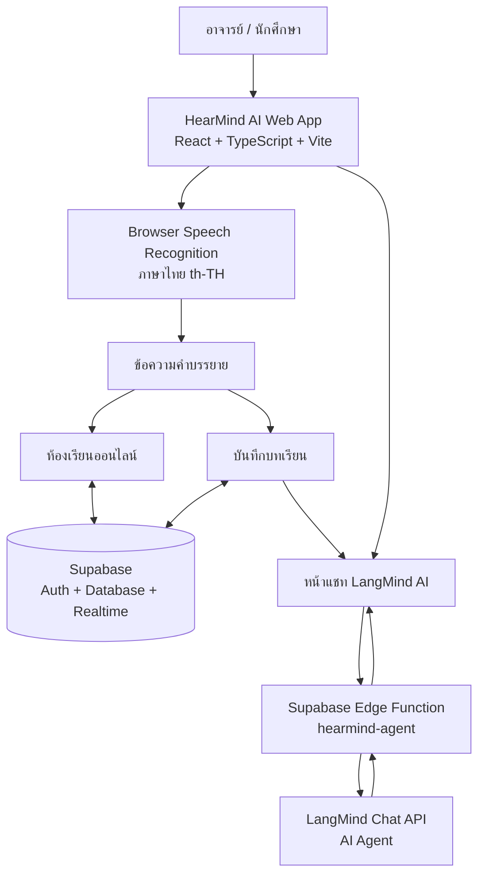

<div align="center">

# HearMind AI

### Learning Without Barriers — ทุกเสียงในห้องเรียนควรเข้าถึงได้

**เว็บแอปพลิเคชันสนับสนุนการเรียนรู้สำหรับนักศึกษาที่หูหนวกหรือหูตึง และผู้เรียนที่ต้องการเข้าถึงเนื้อหาการบรรยายผ่านข้อความ**

แปลงเสียงพูดภาษาไทยเป็นคำบรรยาย • ห้องเรียนออนไลน์ข้ามอุปกรณ์ • บันทึกบทเรียน • ทบทวนกับ **LangMind AI**

**[🌐 ทดลองใช้งาน HearMind AI](https://hearmind-ai.vercel.app/)** · **[💬 ผู้ช่วยการเรียนรู้ LangMind AI](https://hearmind-ai.vercel.app/agent)** · **[📂 GitHub Repository](https://github.com/chutipon21/hearmind-ai)**

</div>

---

## 📖 สารบัญ

1. [รู้จัก HearMind AI](#1-รู้จัก-hearmind-ai)
2. [ปัญหาและแนวคิดเบื้องหลังโครงการ](#2-ปัญหาและแนวคิดเบื้องหลังโครงการ)
3. [กลุ่มผู้ใช้งาน](#3-กลุ่มผู้ใช้งาน)
4. [ฟีเจอร์หลัก](#4-ฟีเจอร์หลัก)
5. [คู่มือใช้งานสำหรับอาจารย์และนักศึกษา](#5-คู่มือใช้งานสำหรับอาจารย์และนักศึกษา)
6. [ตัวอย่างการใช้งานจริง](#6-ตัวอย่างการใช้งานจริง)
7. [LangMind AI ทำหน้าที่อะไร](#7-langmind-ai-ทำหน้าที่อะไร)
8. [สถาปัตยกรรมและเทคโนโลยี](#8-สถาปัตยกรรมและเทคโนโลยี)
9. [เริ่มต้นพัฒนาบนเครื่องของคุณ](#9-เริ่มต้นพัฒนาบนเครื่องของคุณ)
10. [การกำหนดค่า Supabase และ LangMind](#10-การกำหนดค่า-supabase-และ-langmind)
11. [การเผยแพร่เว็บไซต์บน Vercel](#11-การเผยแพร่เว็บไซต์บน-vercel)
12. [การเข้าถึงและประสบการณ์ใช้งาน](#12-การเข้าถึงและประสบการณ์ใช้งาน)
13. [ข้อมูลส่วนบุคคล ความปลอดภัย และความยินยอม](#13-ข้อมูลส่วนบุคคล-ความปลอดภัย-และความยินยอม)
14. [ข้อจำกัดที่ควรทราบ](#14-ข้อจำกัดที่ควรทราบ)
15. [การแก้ปัญหาเบื้องต้น](#15-การแก้ปัญหาเบื้องต้น)
16. [การมีส่วนร่วมและเครดิต](#16-การมีส่วนร่วมและเครดิต)

---

## 1. รู้จัก HearMind AI

**HearMind AI** คือเว็บแอปพลิเคชันเพื่อสนับสนุนการเข้าถึงการเรียนรู้ (Accessible Learning) ที่ออกแบบโดยคำนึงถึงผู้เรียนที่หูหนวกหรือหูตึงเป็นสำคัญ โดยช่วยเปลี่ยนคำบรรยายภาษาไทยให้เป็นข้อความที่อ่านได้บนหน้าจอ และช่วยให้ผู้เรียนสามารถเก็บเนื้อหาไว้ทบทวนต่อด้วยผู้ช่วย **LangMind AI**

แนวคิดของระบบคือ **“เข้าถึงเนื้อหาระหว่างเรียน เข้าใจเนื้อหาหลังเรียน และกลับมาทบทวนได้ตามความต้องการ”**

ระบบไม่ได้มุ่งให้ AI เข้ามาแทนครูผู้สอนหรือล่ามภาษามือ แต่เป็นเครื่องมือ *เสริม* ช่องทางการรับรู้ข้อมูลและช่วยลดอุปสรรคที่อาจเกิดจากการบรรยายด้วยเสียงเพียงอย่างเดียว

### HearMind AI ทำอะไรได้บ้าง?

- **ระหว่างเรียน:** แสดงข้อความจากเสียงพูดภาษาไทยด้วยระบบรู้จำเสียงของเบราว์เซอร์
- **ในห้องเรียนออนไลน์:** อาจารย์สร้างห้องเรียนและส่งคำบรรยายข้อความไปยังอุปกรณ์ของนักศึกษาที่เข้าร่วมด้วยรหัสห้อง
- **หลังเรียน:** บันทึกข้อความเป็นบทเรียน เรียกดูย้อนหลัง และส่งออกไฟล์ `.txt`
- **เมื่ออยากเข้าใจมากขึ้น:** ส่งข้อความบทเรียนให้ **LangMind AI** ช่วยสรุป อธิบาย หรือสร้างคำถามทบทวน
- **เมื่อมีคำถามเพิ่มเติม:** พิมพ์ถาม LangMind AI ต่อเนื่องในหน้าเว็บ โดยไม่ต้องเปลี่ยนไปใช้แชทภายนอก

> **ขอบเขตสำคัญ:** HearMind AI เป็นเครื่องมือสนับสนุนการเรียนรู้ ไม่ใช่ระบบแปลภาษามือ ไม่ใช่บริการล่ามภาษามือ และไม่รับประกันความถูกต้องของการถอดเสียงหรือคำตอบจาก AI ทุกกรณี

## 2. ปัญหาและแนวคิดเบื้องหลังโครงการ

ในห้องเรียนทั่วไป เนื้อหาสำคัญจำนวนมากถูกถ่ายทอดผ่านคำพูด การอธิบายหน้าชั้นเรียน และการถาม–ตอบอย่างรวดเร็ว ผู้เรียนที่หูหนวกหรือหูตึงอาจเข้าถึงเนื้อหาบางส่วนได้ไม่ครบถ้วน โดยเฉพาะเมื่อไม่มีคำบรรยายข้อความหรือเครื่องมือสนับสนุนที่เหมาะสม

นอกจากนี้ ผู้เรียนทุกกลุ่มยังอาจประสบปัญหาคล้ายกัน เช่น จดไม่ทัน ฟังคำศัพท์เฉพาะไม่ชัด ต้องการย้อนอ่านคำอธิบาย หรือไม่ทราบว่าจะเริ่มทบทวนบทเรียนอย่างไร

HearMind AI จึงนำเทคโนโลยีหลายส่วนมาทำงานร่วมกัน ได้แก่ **การรู้จำเสียงพูด (Speech Recognition)**, **ระบบห้องเรียนออนไลน์**, **การจัดเก็บเนื้อหาบทเรียน** และ **AI Agent บนแพลตฟอร์ม LangMind** เพื่อให้เกิดกระบวนการเรียนรู้ที่ต่อเนื่อง ไม่ใช่เพียงการแสดงข้อความชั่วคราว

### วัตถุประสงค์

1. เพิ่มทางเลือกในการเข้าถึงเนื้อหาการเรียนรู้ที่บรรยายด้วยเสียง
2. ช่วยให้นักศึกษาติดตามคำบรรยายภาษาไทยผ่านอุปกรณ์ของตนเองได้
3. สนับสนุนการเก็บรวบรวมและทบทวนเนื้อหาหลังการเรียน
4. ใช้ AI เป็นเครื่องมือช่วยสรุป อธิบาย และสร้างแบบฝึกทบทวนจากเนื้อหาที่ผู้เรียนเลือก
5. ส่งเสริมแนวคิดการออกแบบเทคโนโลยีการศึกษาที่คำนึงถึงความแตกต่างของผู้ใช้งาน

## 3. กลุ่มผู้ใช้งาน

| กลุ่มผู้ใช้ | รูปแบบการใช้ประโยชน์ |
| --- | --- |
| **นักศึกษาที่หูหนวกหรือหูตึง** | อ่านคำบรรยายจากอาจารย์บนหน้าจอ บันทึกเนื้อหา และใช้ AI ช่วยทำความเข้าใจบทเรียน |
| **นักศึกษาทั่วไป** | ใช้ข้อความประกอบการฟัง จัดเก็บสาระสำคัญ และทบทวนเรื่องที่เข้าใจยาก |
| **อาจารย์ / ผู้สอน** | สร้างห้องเรียน เปิดคำบรรยาย และแบ่งปันข้อความกับผู้เข้าร่วม |
| **ล่ามภาษามือ / บุคลากรสนับสนุน** | ใช้ข้อความประกอบการเตรียมเนื้อหาและสนับสนุนการสื่อสาร โดยไม่ถือว่าใช้แทนการล่าม |
| **ผู้พัฒนา / นักวิจัยด้านการศึกษา** | ศึกษาตัวอย่างการผสาน Speech-to-Text, Supabase และ AI Agent ในเว็บแอปเพื่อการเข้าถึง |

## 4. ฟีเจอร์หลัก

### 4.1 คำบรรยายสด (Live Captions)

**หน้า:** [`/live`](https://hearmind-ai.vercel.app/live)

- ใช้ไมโครโฟนของอุปกรณ์ที่เปิดหน้าเว็บเพื่อรู้จำคำพูดภาษาไทย (`th-TH`)
- แสดงข้อความที่ยืนยันแล้วและข้อความชั่วคราวระหว่างประมวลผลตามความสามารถของเบราว์เซอร์
- ปรับขนาดตัวอักษรเพื่อให้อ่านง่ายขึ้น
- เลื่อนติดตามคำบรรยายล่าสุด พร้อมกลับไปอ่านข้อความเก่าได้
- ตั้งชื่อบทเรียน บันทึกข้อความ และส่งออกเป็นไฟล์ `.txt`
- มีช่องยืนยันความยินยอมก่อนเริ่มใช้ไมโครโฟน

**ข้อควรแยกให้ออก:** หน้า *คำบรรยายสด* ทำงานกับไมโครโฟนของอุปกรณ์ปัจจุบันโดยตรง **ไม่ได้กระจายข้อความไปยังผู้ใช้เครื่องอื่น** หากต้องการส่งข้อความข้ามอุปกรณ์ ให้ใช้ฟีเจอร์ *ห้องเรียนออนไลน์*

### 4.2 ห้องเรียนออนไลน์ (Online Classroom)

**หน้า:** [`/classroom`](https://hearmind-ai.vercel.app/classroom)

ฟีเจอร์นี้ออกแบบให้ผู้สอนและผู้เรียนอยู่คนละอุปกรณ์ได้

**ฝั่งอาจารย์**

1. กำหนดชื่อคาบเรียนและกด **สร้างห้องเรียน**
2. ระบบสร้างรหัสเข้าห้องจำนวน 6 ตัวอักษร
3. แชร์รหัสให้เฉพาะผู้เรียนที่ได้รับอนุญาต
4. ยืนยันความยินยอมที่จำเป็น แล้วเปิดไมโครโฟน
5. เมื่อรู้จำเสียงได้และยืนยันข้อความแล้ว ระบบส่งข้อความไปยังผู้เข้าร่วมห้องผ่าน Supabase
6. ปรับขนาดคำบรรยาย บันทึกบทเรียน หรือส่งออกเป็น `.txt`
7. เมื่อจบคาบเรียน กด **ปิดห้องเรียน** เพื่อหยุดการใช้งานห้องนั้น

**ฝั่งนักศึกษา**

1. เปิดหน้า **ห้องเรียนออนไลน์** ด้วยโทรศัพท์ แท็บเล็ต หรือคอมพิวเตอร์
2. ใส่รหัส 6 ตัวที่อาจารย์แจ้งและกด **เข้าร่วมห้องเรียน**
3. อ่านคำบรรยายที่อาจารย์ส่งมาโดยไม่ต้องเปิดไมโครโฟนของตนเอง
4. ปรับขนาดข้อความ อ่านย้อนหลัง และบันทึกบทเรียนในบัญชีของอุปกรณ์ตนเอง
5. หากต้องการทบทวน ให้เปิด **บทเรียนของฉัน**

**รายละเอียดเชิงเทคนิค:** ระบบใช้ Supabase Realtime สำหรับรับข้อความใหม่ และมีกลไกดึงข้อมูลซ้ำเป็นระยะเพื่อช่วยกรณีข้อความเรียลไทม์ตกหล่นหรือการเชื่อมต่อสะดุด ทั้งนี้ความหน่วงขึ้นกับเครือข่ายและการประมวลผลเสียง

> **การบันทึกเป็นรายผู้ใช้:** การที่อาจารย์บันทึกบทเรียน ไม่ได้ทำให้บทเรียนนั้นถูกเพิ่มในรายการส่วนตัวของนักศึกษาทุกคนโดยอัตโนมัติ แต่ละคนสามารถกดบันทึกเนื้อหาที่ได้รับลงในรายการของตนเองได้

### 4.3 ไมโครโฟนส่วนตัว (Personal Microphone)

**หน้า:** [`/personal`](https://hearmind-ai.vercel.app/personal)

สำหรับผู้ที่ต้องการให้เบราว์เซอร์ของอุปกรณ์ตนเองรับเสียงรอบตัวและแสดงเป็นข้อความโดยตรง เช่น การฟังคำอธิบายข้างโต๊ะ หรือการทบทวนในพื้นที่ส่วนตัว

- รับเสียงจากไมโครโฟนของเครื่องผู้ใช้
- แสดงคำบรรยายภาษาไทย
- ปรับขนาดตัวอักษร
- บันทึกหรือส่งออกข้อความ

**ความแตกต่างจากห้องเรียนออนไลน์:** โหมดส่วนตัวไม่ใช่การรับสตรีมข้อความจากไมโครโฟนอาจารย์ในห้องเรียน แต่เป็นการรู้จำเสียงจากอุปกรณ์ของผู้ใช้งานเอง

### 4.4 บทเรียนของฉัน (My Lessons)

**หน้า:** [`/lessons`](https://hearmind-ai.vercel.app/lessons)

- แสดงบทเรียนที่ผู้ใช้บันทึกไว้ พร้อมชื่อ วันเวลา และข้อความคำบรรยาย
- บันทึกลง **Supabase** เพื่อเรียกดูข้อมูลบทเรียนของผู้ใช้นั้น
- มีการเก็บสำเนาในเบราว์เซอร์สำหรับบางขั้นตอนเป็นข้อมูลสำรอง
- ดาวน์โหลดบทเรียนเป็นไฟล์ข้อความ `.txt`
- ลบบทเรียนที่บันทึกไว้บนระบบคลาวด์ผ่านหน้ารายการ
- ส่งบทเรียนที่เลือกไปยังหน้า **LangMind AI** เพื่อสรุปหรืออธิบายต่อได้โดยตรง

> ข้อมูลในเบราว์เซอร์ (`localStorage`) และข้อมูลใน Supabase เป็นคนละแหล่งจัดเก็บ การเปลี่ยนเบราว์เซอร์หรืออุปกรณ์อาจทำให้เข้าถึงข้อมูลสำรองในเครื่องเดิมไม่ได้ และผู้ใช้งานแบบไม่ระบุตัวตนจะมีเซสชันแยกตามเบราว์เซอร์

### 4.5 ผู้ช่วยการเรียนรู้ LangMind AI

**หน้า:** [`/agent`](https://hearmind-ai.vercel.app/agent)

ระบบนี้เชื่อม **AI Agent ที่พัฒนาบนแพลตฟอร์ม LangMind** ผ่าน Supabase Edge Function และแสดงผลภายในเว็บ HearMind AI

ความสามารถที่ผู้ใช้เลือกได้ ได้แก่

| โหมด | ตัวอย่างผลลัพธ์ที่ต้องการ |
| --- | --- |
| **สรุปประเด็นสำคัญ** | สรุปใจความจากบทเรียนให้กระชับ เป็นข้อ ๆ และไม่เติมข้อเท็จจริงที่ไม่รองรับ |
| **อธิบายให้เข้าใจง่าย** | เรียบเรียงเนื้อหาที่ซับซ้อน อธิบายคำศัพท์ และยกตัวอย่างที่สัมพันธ์กับบทเรียน |
| **สร้างคำถามทบทวน** | สร้างคำถาม 5 ข้อ พร้อมเฉลยและเหตุผลประกอบจากเนื้อหาที่ให้ |
| **แชทถาม–ตอบ** | รับคำถามทั่วไปหรือคำถามต่อเนื่องโดยอ้างอิงบริบทบทสนทนาปัจจุบัน |

ผู้ใช้สามารถพิมพ์ข้อความหรือส่งบทเรียนจากหน้า **บทเรียนของฉัน** เข้ามาได้โดยตรง ไม่จำเป็นต้องคัดลอกไปวางบนหน้าแชทภายนอก แต่ยังสามารถเลือกเปิด Agent บนแพลตฟอร์ม LangMind ได้เช่นกัน

การสนทนาต่อเนื่องใช้ `conversation_id` และโทเคนอ้างอิงบทสนทนาผ่านส่วนติดต่อของ Edge Function ส่วนประวัติแชทที่แสดงในเว็บไม่ได้ถูกบันทึกเป็นประวัติถาวรใน `localStorage` ดังนั้นควรเก็บผลลัพธ์สำคัญด้วยตนเองเมื่อจำเป็น

### 4.6 ธีมและการแสดงผล

- เลือก **สว่าง (Light)**, **มืด (Dark)** หรือ **ตามอุปกรณ์ (System)**
- รองรับหน้าจอคอมพิวเตอร์และโทรศัพท์ตามโครงสร้าง Responsive Web
- ใช้รูปแบบปุ่ม กล่องข้อความ และสถานะต่าง ๆ ที่เน้นการอ่านง่าย
- มีการบอกสถานะสำคัญด้วยข้อความประกอบ ไม่อาศัยสีเพียงอย่างเดียว

## 5. คู่มือใช้งานสำหรับอาจารย์และนักศึกษา

### กรณี A — อาจารย์ต้องการแสดงข้อความบนคอมพิวเตอร์ของตน

1. เปิด [HearMind AI](https://hearmind-ai.vercel.app/) แล้วเข้าเมนู **คำบรรยายสด**
2. ตรวจว่าเบราว์เซอร์รองรับการรู้จำเสียง
3. อ่านและยืนยันการขอความยินยอม จากนั้นอนุญาตไมโครโฟนในเบราว์เซอร์
4. กด **เริ่มไมโครโฟน** และพูดภาษาไทยให้ชัดเจน
5. ปรับขนาดข้อความและตรวจเนื้อหาที่ระบบแสดง
6. กด **บันทึกบทเรียน** หรือ **ส่งออก .txt** เมื่อมีข้อความที่ต้องการเก็บไว้

### กรณี B — อาจารย์ต้องการให้นักศึกษาอ่านข้อความบนโทรศัพท์

1. อาจารย์เปิด **ห้องเรียนออนไลน์** และสร้างห้องใหม่
2. ส่งรหัสห้องให้ผู้เรียนในคาบนั้น
3. นักศึกษาเปิดหน้าเว็บบนอุปกรณ์ของตนและใส่รหัส
4. อาจารย์เปิดไมโครโฟนหลังจากยืนยันความยินยอม
5. นักศึกษาจะเห็นข้อความคำบรรยายที่ระบบส่งมา โดยไม่ต้องเปิดไมโครโฟนตนเอง
6. ทั้งสองฝ่ายสามารถกดบันทึกบทเรียนของตน และเปิดอ่านใน **บทเรียนของฉัน**
7. อาจารย์ปิดห้องเมื่อจบคาบ

### กรณี C — นักศึกษาต้องการทบทวนบทเรียนด้วย AI

1. เปิด **บทเรียนของฉัน** แล้วเลือกเนื้อหาที่บันทึกไว้
2. กด **ส่งไปแชท LangMind AI** หรือเปิดหน้า **ผู้ช่วยการเรียนรู้** แล้ววางข้อความเอง
3. เลือก **สรุป**, **อธิบายให้เข้าใจง่าย** หรือ **สร้างคำถามทบทวน**
4. กด **ส่งบทเรียนให้ LangMind AI** และอ่านคำตอบ
5. หากต้องการให้ AI อธิบายต่อ ให้พิมพ์คำถามในช่องแชทเดียวกัน
6. ตรวจสอบความถูกต้องของคำตอบ โดยเฉพาะคำศัพท์เฉพาะ ตัวเลข และเนื้อหาที่ถอดเสียงอาจคลาดเคลื่อน

## 6. ตัวอย่างการใช้งานจริง

**สถานการณ์:** อาจารย์กำลังสอนเรื่อง *Internet of Things (IoT)* ในห้องเรียน

1. อาจารย์สร้างห้องเรียนชื่อ “พื้นฐาน IoT” แล้วแชร์รหัสให้ผู้เรียน
2. นักศึกษาเข้าห้องผ่านโทรศัพท์และอ่านคำอธิบายที่ถูกถอดเป็นข้อความ เช่น “IoT คือการเชื่อมต่ออุปกรณ์ต่าง ๆ ผ่านเครือข่ายเพื่อรับส่งข้อมูล”
3. ระหว่างเรียน นักศึกษาสามารถเลื่อนอ่านคำอธิบายก่อนหน้าได้
4. หลังจบคาบ นักศึกษากด **บันทึกบทเรียน**
5. นักศึกษาเปิดรายการบทเรียน แล้วเลือก **ส่งไปแชท LangMind AI**
6. เลือก **อธิบายให้เข้าใจง่าย** เพื่อขอคำอธิบาย IoT พร้อมตัวอย่าง
7. ถามต่อว่า “ช่วยยกตัวอย่างอุปกรณ์ IoT ที่ใช้ในห้องเรียนอีก 3 อย่าง”
8. เลือกสร้างคำถามทบทวนเพื่อตรวจสอบความเข้าใจ

กระบวนการนี้แสดงแนวคิดหลักของแอป: **คำบรรยาย → บันทึก → ทำความเข้าใจ → ทบทวน**

## 7. LangMind AI ทำหน้าที่อะไร

HearMind AI เป็น **เว็บแอปที่ออกแบบประสบการณ์การเรียนรู้และเชื่อมระบบต่าง ๆ เข้าด้วยกัน** ส่วน **LangMind AI** คือแพลตฟอร์มและระบบ AI Agent ที่ใช้ประมวลผลคำถามและบทเรียนภายในฟีเจอร์ผู้ช่วยการเรียนรู้

- **HearMind AI ดูแล:** หน้าเว็บ การแสดงคำบรรยาย การจัดการห้องเรียน การบันทึกบทเรียน และการนำข้อมูลเข้าสู่หน้า AI
- **LangMind AI สนับสนุน:** การประมวลผลภาษาธรรมชาติ การสรุปบทเรียน การอธิบายเนื้อหา การสร้างคำถาม และการสนทนาต่อเนื่องผ่าน Agent
- **Supabase Edge Function ทำหน้าที่:** รับคำขอจากเว็บไซต์ ตรวจสอบเซสชันผู้ใช้ และเรียก LANGMIND API โดยเก็บ API Key ไว้ฝั่งเซิร์ฟเวอร์

การถอดเสียงภาษาไทยในโหมดปัจจุบันใช้ **Speech Recognition ของเบราว์เซอร์** ไม่ได้เกิดจาก LangMind AI โดยตรง และไม่ควรตีความว่า LangMind เป็นผู้พัฒนาเว็บไซต์ทั้งหมด

**ลิงก์ Agent บน LangMind:** [เปิดหน้าแชทบน LangMind](https://langmind.in.th/public/agents/44ca28a5-abd9-46da-88cb-814eb6866f7c/chat)

## 8. สถาปัตยกรรมและเทคโนโลยี

### ภาพรวมการทำงาน



> แผนภาพแสดงองค์ประกอบและการไหลของข้อมูลในภาพรวม ไม่ได้หมายความว่าทุกคำบรรยายจะถูกส่งเข้า LangMind โดยอัตโนมัติ ผู้ใช้ต้องเลือกส่งเนื้อหาให้ AI ก่อน

### เทคโนโลยีที่ใช้

| ส่วนประกอบ | เทคโนโลยี | บทบาท |
| --- | --- | --- |
| Frontend | **React 18 + TypeScript** | สร้างส่วนติดต่อผู้ใช้และจัดการสถานะแอป |
| Build tool | **Vite** | รันเว็บไซต์ระหว่างพัฒนาและสร้าง Production Build |
| Styling | **Tailwind CSS** | ออกแบบหน้าจอ Responsive รวมถึง Light / Dark Theme |
| Navigation | **React Router** | จัดการหน้า Dashboard, Captions, Classroom, Lessons, AI และ Settings |
| UI Icons | **Lucide React** | ไอคอนภายในระบบ |
| Speech-to-Text | **Browser Speech Recognition / Web Speech API** | รับเสียงจากไมโครโฟนและรู้จำคำพูดภาษาไทย |
| Backend | **Supabase** | เซสชันผู้ใช้ ฐานข้อมูล และการจัดเก็บบทเรียน |
| Live data | **Supabase Realtime** | ส่งคำบรรยายใหม่ระหว่างอุปกรณ์ในห้องเดียวกัน |
| Server-side API | **Supabase Edge Functions** | เชื่อม LangMind API โดยไม่เผยแพร่ API Key ลง Frontend |
| AI Agent | **LangMind AI / LangMind Agent Studio** | สรุป อธิบาย ตั้งคำถาม และตอบคำถามจากบทเรียน |
| Hosting | **Vercel** | เผยแพร่เว็บแอปผ่าน HTTPS |
| Source control | **Git / GitHub** | จัดเก็บและติดตามการเปลี่ยนแปลงโค้ด |

### เส้นทางการทำงานหลัก

| เส้นทาง | หน้าที่ |
| --- | --- |
| `/` | ภาพรวมและทางเข้าสู่ฟีเจอร์หลัก |
| `/live` | คำบรรยายสดจากไมโครโฟนเครื่องปัจจุบัน |
| `/classroom` | สร้างห้องเรียนหรือเข้าร่วมด้วยรหัส |
| `/classroom/:id` | หน้าคำบรรยายของห้องเรียนออนไลน์ |
| `/personal` | คำบรรยายจากไมโครโฟนส่วนตัว |
| `/lessons` | คลังบทเรียนและการส่งเนื้อหาเข้า AI |
| `/agent` | แชท LangMind AI ภายในเว็บไซต์ |
| `/settings` | ตั้งค่าธีมและการเข้าถึง |

### โครงสร้างโปรเจกต์โดยสังเขป

```text
hearmind-ai/
├── public/                     # ไฟล์สาธารณะของเว็บไซต์
├── src/
│   ├── components/
│   │   └── Classroom.tsx      # สร้าง/เข้าร่วมห้องและคำบรรยายข้ามอุปกรณ์
│   ├── hooks/
│   │   ├── useSpeechRecognition.ts
│   │   └── useTheme.ts
│   ├── lib/
│   │   ├── storage.ts         # จัดเก็บและจัดการบทเรียน
│   │   └── supabase.ts        # Supabase Client และ Anonymous Auth
│   ├── App.tsx                # หน้าแอปและ React Router
│   ├── main.tsx
│   └── styles.css
├── supabase/                   # ทรัพยากร SQL/การตั้งค่าที่มีใน Repository
├── .env.example
├── package.json
├── vercel.json
└── README.md
```

โครงสร้างนี้แสดงไฟล์หลักตามเวอร์ชันที่ใช้พัฒนา หากมีการจัดระเบียบไฟล์ใหม่ในอนาคต ให้ยึดโครงสร้าง Repository ปัจจุบันเป็นหลัก

## 9. เริ่มต้นพัฒนาบนเครื่องของคุณ

### สิ่งที่ต้องมี

- Node.js รุ่น LTS ที่รองรับ Vite ของโปรเจกต์ (แนะนำ Node.js 20 หรือใหม่กว่าในรุ่นที่รองรับ)
- npm
- Git และโปรแกรมแก้ไขโค้ด เช่น VS Code
- เบราว์เซอร์ Chrome หรือ Edge สำหรับทดสอบไมโครโฟน
- Supabase Project ที่ตั้งค่าฐานข้อมูลและการยืนยันตัวตนสำหรับแอปนี้
- LangMind API Key ที่ได้รับสิทธิ์เรียก AI Agent สำหรับผู้ที่ต้องการเปิดใช้หน้า AI ในโปรเจกต์ของตน

### 9.1 ดาวน์โหลดซอร์สโค้ด

```bash
git clone https://github.com/chutipon21/hearmind-ai.git
cd hearmind-ai
```

### 9.2 ติดตั้ง Dependencies

```bash
npm install
```

### 9.3 ตั้งค่า Environment Variables

สร้างไฟล์ `.env.local` ในโฟลเดอร์หลัก หรือคัดลอกจาก `.env.example` แล้วใส่ค่าของ Supabase Project ของคุณ

```dotenv
VITE_SUPABASE_URL=https://YOUR_PROJECT.supabase.co
VITE_SUPABASE_ANON_KEY=YOUR_SUPABASE_PUBLISHABLE_OR_ANON_KEY
```

**สำคัญ:** ใช้เฉพาะ **Supabase Publishable/Anon Key** ในตัวแปร `VITE_` เท่านั้น ห้ามใส่ `service_role`, `sb_secret_...` หรือ `LANGMIND_API_KEY` ในไฟล์หรือค่าที่ฝังไปกับ Frontend เนื่องจาก `VITE_` ถูกนำไปอยู่ใน JavaScript ฝั่งเบราว์เซอร์

### 9.4 เปิดเซิร์ฟเวอร์สำหรับพัฒนา

```bash
npm run dev
```

เปิด URL ที่ Terminal แสดง (โดยทั่วไปคือ `http://localhost:5173`)

### 9.5 ตรวจสอบโค้ดก่อนเผยแพร่

```bash
npm run typecheck
npm run build
npm run preview
```

`build` จะตรวจ TypeScript และสร้างไฟล์ในโฟลเดอร์ `dist/` ตามการตั้งค่าของโปรเจกต์

> **หมายเหตุสำหรับผู้พัฒนาที่ Fork โครงการ:** การ Clone Repository เพียงอย่างเดียวไม่ได้สร้างฐานข้อมูล Supabase หรือ Edge Function ในบัญชีของคุณโดยอัตโนมัติ ต้องตั้งค่าบริการฝั่งเซิร์ฟเวอร์และสิทธิ์ให้ตรงกับแอปเพิ่มเติม

## 10. การกำหนดค่า Supabase และ LangMind

### 10.1 Supabase

แอปปัจจุบันใช้ Supabase สำหรับการจัดการเซสชันแบบไม่ระบุตัวตน (Anonymous Auth), ห้องเรียน, สมาชิกห้อง, คำบรรยาย และบทเรียนบนคลาวด์

ผู้ที่ต้องการ Deploy ระบบของตนเองต้องตรวจสอบอย่างน้อยว่า

1. เปิดใช้ **Anonymous Sign-ins** ใน Supabase Authentication ตามรูปแบบที่แอปเรียกใช้งาน
2. สร้างโครงสร้างตารางสำหรับ `classrooms`, `classroom_members`, `captions` และระบบบันทึกบทเรียนให้ตรงกับโค้ดที่ใช้จริง
3. จัดให้มี RPC สำหรับ **สร้างห้องเรียน** และ **เข้าร่วมห้องเรียน** รวมถึงชื่อพารามิเตอร์ที่ตรงกับโค้ด
4. เปิดใช้ **Row Level Security (RLS)** และกำหนดสิทธิ์ของอาจารย์ สมาชิกห้อง และเจ้าของบทเรียนอย่างเหมาะสม
5. ตั้งค่า Supabase Realtime ให้ติดตามข้อความคำบรรยายของห้องเรียนได้
6. ทดสอบการสร้างห้อง เข้าร่วม บันทึกบทเรียน และสิทธิ์ของผู้ใช้งานต่างเซสชันก่อนนำข้อมูลจริงเข้าระบบ

**ข้อควรระวังเรื่อง SQL:** หากพบไฟล์ `supabase/setup.sql` ใน Repository ให้ตรวจสอบก่อนว่าโครงสร้างและนโยบายตรงกับฐานข้อมูลปัจจุบันหรือไม่ เพราะโครงสร้างห้องเรียนมีการปรับปรุงระหว่างพัฒนา **ไม่ควรนำ SQL รุ่นเก่าไปรันซ้ำบนฐานข้อมูล Production โดยไม่ตรวจสอบ**

การใช้ Anonymous Auth หมายถึงผู้ใช้มีเซสชันที่ระบบรู้จัก แต่ **ไม่ได้ยืนยันตัวบุคคลด้วยชื่อ/อีเมล** และผู้ใช้บนคนละเบราว์เซอร์อาจได้รับ User ID คนละชุด

### 10.2 Supabase Edge Function

ฟังก์ชันที่ใช้เชื่อม AI มีชื่อ **`hearmind-agent`** และทำงานฝั่ง Supabase Edge Functions โดยมีหน้าที่หลักดังนี้

- รับข้อความคำถามจากเว็บไซต์
- ตรวจสอบเซสชันผู้ใช้ Supabase ก่อนให้เรียก AI
- ตรวจสอบความยาวและรูปแบบข้อความ
- อ่าน API Key จาก Supabase Function Secrets
- เรียก LangMind Chat API โดยใช้ Agent ที่ตั้งค่าไว้
- ส่งคำตอบและข้อมูลบทสนทนากลับไปยังเว็บไซต์

ตั้ง Secret ใน Supabase Dashboard (ไม่ใช่ไฟล์ `.env.local` ของ Frontend):

```text
LANGMIND_API_KEY = [YOUR_LANGMIND_API_KEY]
```

การ Deploy Edge Function เป็นขั้นตอนแยกจากการ Deploy หน้าเว็บ และต้องใช้ซอร์สโค้ด/การตั้งค่าฟังก์ชันที่สอดคล้องกับเวอร์ชัน Frontend หาก Repository ที่ Fork ยังไม่มีซอร์สฟังก์ชันครบ ไม่ควรสรุปว่า Fork แล้วจะเปิดใช้ AI ได้ทันที

### 10.3 LangMind AI

ผู้ดูแลโครงการต้องมี Agent ที่ใช้งานได้ และ API Key ที่ได้รับสิทธิ์ **สนทนากับ Agent** (`chat:invoke`) พร้อมกำหนด Agent ID ให้ถูกต้องใน Edge Function

**อย่าแชร์ API Key จริงใน Issue, Commit, ภาพหน้าจอ หรือ Client-side Code** และควรจำกัดการเรียก API ตามโควตาของบัญชีที่ใช้งาน

### 10.4 ภาพรวม Environment Variables

| ชื่อ | เก็บที่ใด | เปิดเผยใน Browser ได้หรือไม่ |
| --- | --- | --- |
| `VITE_SUPABASE_URL` | Frontend / Vercel Environment Variables | ได้ (เป็น Project URL) |
| `VITE_SUPABASE_ANON_KEY` | Frontend / Vercel Environment Variables | ได้ เฉพาะ Publishable/Anon Key และต้องมี RLS ที่เหมาะสม |
| `LANGMIND_API_KEY` | **Supabase Edge Function Secrets เท่านั้น** | **ไม่ได้** |

## 11. การเผยแพร่เว็บไซต์บน Vercel

แอปตัวอย่างเผยแพร่ผ่าน **Vercel** โดยเชื่อมกับ GitHub Repository

ขั้นตอนสำหรับผู้พัฒนาที่ต้องการ Deploy เอง:

1. Push โค้ดไปยัง GitHub Repository ของคุณ
2. เปิด Vercel แล้วเลือก **Add New → Project** และ Import Repository
3. เลือก Framework Preset เป็น **Vite**
4. ใช้ Build Command `npm run build` และ Output Directory `dist`
5. เพิ่ม `VITE_SUPABASE_URL` และ `VITE_SUPABASE_ANON_KEY` ใน Production Environment Variables
6. ตรวจสอบ `vercel.json` สำหรับการเปิดเส้นทาง React Router โดยตรง เช่น `/agent` และ `/classroom`
7. Deploy แล้วทดสอบหน้าเว็บไซต์ทุกส่วนบน HTTPS
8. ตรวจสอบอีกครั้งว่า Supabase Edge Function และการกำหนดสิทธิ์ฐานข้อมูลทำงานในโดเมนจริง

หลังแก้ Environment Variables ของ Vite บน Vercel ต้อง **สร้าง Deployment ใหม่** เพื่อให้ค่าถูกนำไปใช้ใน Build ใหม่

## 12. การเข้าถึงและประสบการณ์ใช้งาน

HearMind AI ออกแบบโดยคำนึงถึงการอ่านข้อความเป็นส่วนสำคัญของประสบการณ์ใช้งาน ได้แก่

- ใช้คำบรรยายข้อความเป็นอีกช่องทางหนึ่งในการเข้าถึงเนื้อหาที่พูด
- มีตัวเลือกปรับขนาดข้อความในหน้าคำบรรยาย
- ใช้ข้อความร่วมกับสัญลักษณ์เพื่อแสดงสถานะไมโครโฟนและการเชื่อมต่อ
- เปิดอ่านเนื้อหาก่อนหน้าได้ โดยไม่บังคับให้หน้าจอเลื่อนตามข้อความใหม่ตลอดเวลา
- มีรูปแบบ Light / Dark / System เพื่อให้เลือกการแสดงผลได้ตามความสะดวก
- นำบทเรียนที่อ่านไม่เข้าใจไปให้ AI อธิบายซ้ำเป็นภาษาง่ายได้

**โปรดทราบ:** การออกแบบเพื่อการเข้าถึงไม่ได้หมายความว่าเว็บไซต์ผ่านการตรวจประเมินมาตรฐาน WCAG ในทุกข้อแล้ว การทดสอบจริงร่วมกับผู้ใช้ที่หูหนวกหรือหูตึง และการปรับปรุงจากข้อเสนอแนะยังมีความสำคัญ

## 13. ข้อมูลส่วนบุคคล ความปลอดภัย และความยินยอม

การใช้งานแอปอาจเกี่ยวข้องกับเสียงพูด ข้อความบรรยาย เนื้อหาบทเรียน และคำถามที่ผู้ใช้ส่งให้ AI จึงควรใช้อย่างระมัดระวัง

### การไหลของข้อมูลที่ควรรู้

| ข้อมูล | แนวทางที่ระบบใช้ |
| --- | --- |
| เสียงจากไมโครโฟน | รับผ่านเบราว์เซอร์เพื่อทำ Speech Recognition; ผู้ให้บริการเบราว์เซอร์อาจประมวลผลเสียงบนเซิร์ฟเวอร์ของตน |
| คำบรรยายสดจากอุปกรณ์เดียว | แสดงในแอป; เมื่อผู้ใช้กดบันทึก จึงเข้าสู่ขั้นตอนจัดเก็บบทเรียน |
| คำบรรยายในห้องเรียนออนไลน์ | ข้อความที่ยืนยันแล้วถูกส่งไปยัง Supabase เพื่อให้สมาชิกห้องอ่านได้ |
| บทเรียนที่บันทึก | เก็บใน Supabase และอาจมีสำเนาอยู่ใน `localStorage` ของอุปกรณ์ตามฟีเจอร์ |
| ข้อความที่ส่งให้ AI | ส่งผ่าน Supabase Edge Function ไปยัง LangMind API เมื่อผู้ใช้สั่งให้ประมวลผล |
| ประวัติแชทภายในหน้าปัจจุบัน | แสดงระหว่างใช้งานหน้าแชท; ไม่ได้เก็บเป็นประวัติถาวรใน `localStorage` ของฟีเจอร์ AI |

### แนวทางใช้งานอย่างรับผิดชอบ

1. **ขอความยินยอมอย่างเหมาะสม** จากผู้เกี่ยวข้องก่อนเปิดไมโครโฟน ถ่ายทอดหรือบันทึกคำบรรยาย
2. แจ้งผู้เรียนให้ทราบว่ามีการถอดเสียงข้อความและอาจมีการส่งข้อมูลไปยังบริการภายนอก
3. หลีกเลี่ยงการส่งชื่อจริง รหัสประจำตัว เบอร์โทรศัพท์ ข้อมูลสุขภาพ และข้อมูลอ่อนไหวเข้า AI หากไม่จำเป็น
4. ไม่เผยแพร่รหัสห้องเรียนหรือข้อมูลบทเรียนที่มีรายละเอียดส่วนตัวต่อสาธารณะ
5. หากใช้คอมพิวเตอร์ร่วมกับผู้อื่น ให้ระวังข้อมูลสำรองในเบราว์เซอร์และเซสชันที่ค้างอยู่
6. ผู้ดูแลระบบควรตรวจ RLS, สิทธิ์ฐานข้อมูล, การจำกัดคำขอ และการจัดเก็บ Secret ก่อนเปิดให้ผู้ใช้จำนวนมากเข้าใช้งาน

**คำอธิบายขอบเขต:** README นี้อธิบายพฤติกรรมที่ปรากฏในโค้ด ไม่ใช่นโยบายความเป็นส่วนตัวทางกฎหมายหรือคำรับรองการปฏิบัติตามกฎหมายคุ้มครองข้อมูลส่วนบุคคล หากนำระบบไปใช้กับข้อมูลจริงในสถาบันการศึกษา ควรจัดทำประกาศความเป็นส่วนตัว ระยะเวลาจัดเก็บ และกระบวนการขอลบข้อมูลให้ชัดเจน

## 14. ข้อจำกัดที่ควรทราบ

- **ความแม่นยำของ Speech Recognition ไม่คงที่:** ขึ้นกับไมโครโฟน สัญญาณอินเทอร์เน็ต เสียงรบกวน สำเนียง และความสามารถของเบราว์เซอร์
- **การรองรับเบราว์เซอร์แตกต่างกัน:** แนะนำ Chrome หรือ Edge และการใช้งานผ่าน HTTPS หรือ `localhost`; ไม่รับประกันการทำงานเหมือนกันทุกอุปกรณ์
- **ไม่ใช่การแปลภาษามือ:** ไม่มีการตีความหรือสร้างภาษามือแทนล่าม
- **ไม่รับประกันความถูกต้องของ AI:** AI อาจเข้าใจคำศัพท์ผิด ตอบไม่ครบ หรือสร้างข้อมูลคลาดเคลื่อน ผู้ใช้ควรตรวจสอบกับแหล่งเรียนรู้ที่น่าเชื่อถือ
- **บัญชีแบบไม่ระบุตัวตน:** บทเรียนบนคลาวด์ผูกกับเซสชัน/ผู้ใช้ที่ระบบสร้าง จึงไม่ใช่ระบบลงชื่อเข้าใช้และซิงก์ข้อมูลข้ามทุกอุปกรณ์ด้วยบัญชีบุคคลเดียวกันโดยอัตโนมัติ
- **บทสนทนา AI ไม่ใช่ประวัติถาวร:** การรีเฟรชหรือออกจากหน้าอาจทำให้ข้อความที่แสดงในหน้าแชทหายไป
- **มีข้อจำกัดปริมาณข้อความ:** การส่งคำถามและเนื้อหาให้ฟังก์ชัน AI ถูกจำกัดความยาวตามการตรวจสอบของระบบ (ข้อความรวมต้องไม่เกิน 8,000 ตัวอักษรในคำขอหนึ่งครั้ง)
- **ความเร็วในการส่งคำบรรยายไม่ใช่ศูนย์:** การประมวลผลเสียงและส่งข้อมูลข้ามอุปกรณ์อาจเกิดความหน่วงตามสภาพเครือข่าย
- **โควตาการใช้ API:** การเรียก LangMind API ขึ้นกับสิทธิ์และโควตาของบัญชีผู้ให้บริการที่เชื่อมอยู่

## 15. การแก้ปัญหาเบื้องต้น

<details>
<summary><strong>กดเริ่มไมโครโฟนไม่ได้</strong></summary>

- ใช้ Chrome หรือ Edge รุ่นที่รองรับการรู้จำเสียง
- เปิดเว็บผ่าน `https://` หรือ `localhost`
- ตรวจว่าได้ทำเครื่องหมายยืนยันความยินยอมแล้ว
- ตรวจสิทธิ์ไมโครโฟนของเว็บไซต์ในเบราว์เซอร์และระบบปฏิบัติการ
- ลองปิดโปรแกรมอื่นที่กำลังใช้ไมโครโฟน แล้วเปิดใหม่
</details>

<details>
<summary><strong>นักศึกษาเข้าห้องเรียนด้วยรหัสไม่ได้</strong></summary>

- ตรวจว่ารหัสมี 6 ตัวและกรอกถูกต้อง
- ตรวจว่าอาจารย์ยังไม่ปิดห้องเรียน
- ตรวจการเชื่อมต่ออินเทอร์เน็ตและการเข้าสู่ระบบแบบไม่ระบุตัวตน
- หากเป็นระบบที่ติดตั้งเอง ให้ตรวจ RPC, RLS และสิทธิ์ของตารางห้องเรียนใน Supabase
</details>

<details>
<summary><strong>เห็นข้อความที่เครื่องอาจารย์ แต่เครื่องนักศึกษาไม่อัปเดต</strong></summary>

- ยืนยันว่าทั้งสองเครื่องอยู่ในห้องเดียวกัน
- ตรวจสถานะการเชื่อมต่อที่หน้าห้องเรียน
- รอสักครู่สำหรับการดึงข้อมูลสำรอง แล้วลองรีเฟรชหน้า
- ตรวจ Supabase Realtime และสิทธิ์ SELECT ของสมาชิกห้อง
</details>

<details>
<summary><strong>กดบันทึกบทเรียนแล้วไม่พบใน “บทเรียนของฉัน”</strong></summary>

- ตรวจข้อความแจ้งเตือนหลังบันทึกว่า Supabase สำเร็จหรือไม่
- ตรวจว่ามีคำบรรยายที่ยืนยันแล้วอย่างน้อย 1 ข้อความ
- เปิดรายการบทเรียนบนอุปกรณ์/เซสชันที่กดบันทึก
- หากใช้ระบบที่ติดตั้งเอง ให้ตรวจการตั้งค่า Supabase ตารางบทเรียนและ RLS
- แยกให้ออกระหว่างบทเรียนสำรองใน `localStorage` กับรายการบทเรียนบนคลาวด์
</details>

<details>
<summary><strong>หน้า LangMind AI ส่งข้อความไม่ได้ หรือขึ้น 401 / 403 / 429</strong></summary>

- ตรวจว่า Supabase Authentication คืน User Session ที่ใช้งานได้
- ตรวจว่า Edge Function `hearmind-agent` Deploy และรับคำขอได้
- ตรวจว่า LANGMIND API Key ถูกเก็บไว้ใน Supabase Secrets และมีสิทธิ์เรียก Agent
- `401` มักเกี่ยวข้องกับการยืนยันตัวตน, `403` เกี่ยวกับสิทธิ์, `429` เกี่ยวกับข้อจำกัดการใช้งาน แต่ควรดู Response จริงเพื่อยืนยัน
- อย่าส่ง JWT หรือ API Key ลง GitHub Issue / ภาพหน้าจอ
</details>

<details>
<summary><strong>เปิดลิงก์ /agent หรือ /classroom โดยตรงแล้วพบ 404</strong></summary>

ตรวจว่ามีการตั้งค่า SPA Rewrite ใน `vercel.json` และ Deployment ใช้การตั้งค่าล่าสุดของโปรเจกต์
</details>

## 16. การมีส่วนร่วมและเครดิต

### ผู้พัฒนาและแหล่งโค้ด

- **โครงการ:** HearMind AI — Learning Without Barriers
- **ซอร์สโค้ด:** [github.com/chutipon21/hearmind-ai](https://github.com/chutipon21/hearmind-ai)
- **เว็บไซต์:** [hearmind-ai.vercel.app](https://hearmind-ai.vercel.app/)

ผู้สนใจสามารถศึกษาแนวทางออกแบบระบบ ส่งข้อเสนอแนะหรือรายงานปัญหาผ่านหน้า [GitHub Issues](https://github.com/chutipon21/hearmind-ai/issues) โดยไม่เปิดเผยข้อมูลส่วนบุคคลหรือคีย์ลับในรายงาน

### เทคโนโลยีและผู้ให้บริการที่มีส่วนสำคัญ

ขอขอบคุณแพลตฟอร์มและโครงการโอเพนซอร์สที่ช่วยให้ระบบนี้เกิดขึ้นได้ ได้แก่ **LangMind AI / LangMind Agent Studio**, **Supabase**, **React**, **TypeScript**, **Vite**, **Tailwind CSS**, **Lucide**, **GitHub** และ **Vercel**

**การให้เครดิต:** ฟีเจอร์ผู้ช่วยการเรียนรู้ภายใน HearMind AI ขับเคลื่อนด้วย AI Agent บนแพลตฟอร์ม LangMind; ส่วนเว็บไซต์ การจัดการห้องเรียน คำบรรยาย และประสบการณ์ใช้งานเป็นองค์ประกอบของโครงการ HearMind AI การระบุชื่อผู้ให้บริการไม่ใช่การอ้างว่าโครงการได้รับการรับรองอย่างเป็นทางการจากทุกองค์กรที่กล่าวถึง

### สิทธิ์ในการใช้งานซอร์สโค้ด

โปรดตรวจสอบไฟล์ `LICENSE` ใน Repository ก่อนนำโค้ดไปคัดลอก ดัดแปลง หรือแจกจ่าย หากยังไม่มีการระบุใบอนุญาตอย่างชัดเจน การเปิดเผยซอร์สโค้ดบน GitHub **ไม่ได้หมายความว่าอนุญาตให้นำไปใช้ได้โดยไม่มีเงื่อนไข**

---

<div align="center">

### HearMind AI — Learning Without Barriers

**เทคโนโลยีการศึกษาที่ช่วยเปลี่ยนคำบรรยายให้เป็นโอกาสในการเรียนรู้**

[เริ่มใช้งาน HearMind AI](https://hearmind-ai.vercel.app/) · [สนทนากับ LangMind AI](https://hearmind-ai.vercel.app/agent)

</div>
